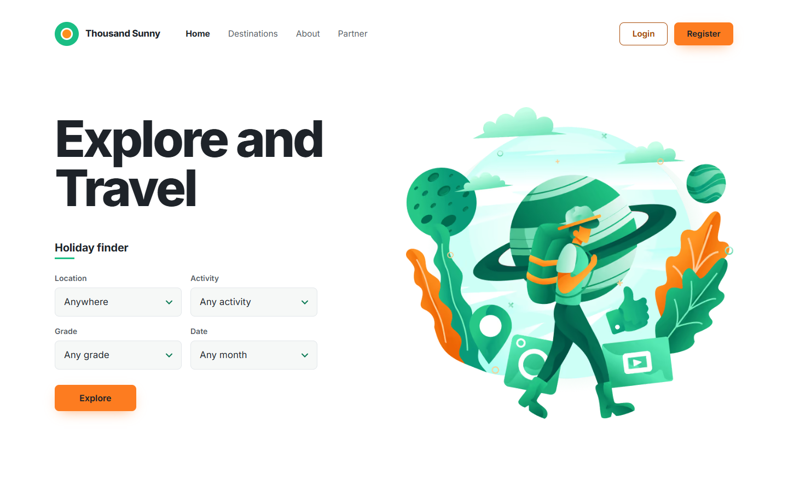
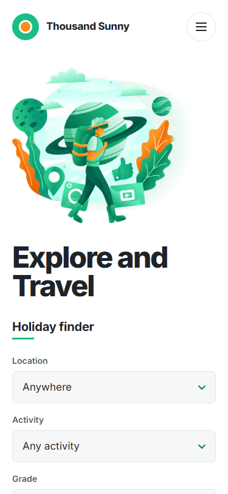

# Tour — Thousand Sunny

A travel landing page for Thousand Sunny, a fictional tour brand, with a holiday finder that actually filters trips.





**Live demo:** https://vovaddk.github.io/Tour/

> Practice project — not affiliated with Lonely Planet.

## Stack

- [Astro 7](https://astro.build) (static output), TypeScript in strict mode
- Scoped component CSS with design tokens as custom properties, no CSS framework
- Inter Variable, self-hosted through Fontsource
- `astro:assets` `<Picture>` for responsive AVIF/WebP images
- ESLint (typescript-eslint, eslint-plugin-astro), Prettier, `astro check`
- Vitest for the finder logic, Playwright + axe-core for smoke and accessibility tests
- GitHub Actions for CI and GitHub Pages deployment

## Features

- **Holiday finder:** location, activity, grade and month selects filter a small trip catalogue (`src/data/trips.ts`). Results appear under the form with a live status message, and nothing is sent anywhere.
- **Testimonial carousel:** previous/next buttons with a polite live region, cross-fading photos and hidden inactive slides.
- **Mobile menu:** disclosure button with `aria-expanded`, closes on Escape or link click.
- **Popovers** (native Popover API, no JS) explain the Login/Register and Download buttons, since there is no backend.
- **Accessibility:** landmarks, skip link, one `h1` and ordered headings, labelled controls, visible focus rings, `prefers-reduced-motion` support. Orange buttons use dark text to keep the brand colour at AA contrast.
- **SEO:** title, description, canonical, Open Graph and Twitter cards, `TravelAgency` JSON-LD, sitemap and `robots.txt`.

## Project structure

```text
src/
  assets/        photos and illustrations, optimised at build time
  components/    one component per section (Header, Hero, HolidayFinder, Explore,
                 Destinations, Guides, Testimonials, Stories, Footer, Logo)
  data/          trips catalogue + finder logic (with unit tests), social icons
  layouts/       BaseLayout with meta tags and fonts
  pages/         index.astro
  styles/        global tokens and base styles
tests/e2e/       Playwright smoke and axe tests
```

## Scripts

| Command           | What it does                                             |
| ----------------- | -------------------------------------------------------- |
| `npm run dev`     | Start the dev server                                     |
| `npm run build`   | Build the static site into `dist/`                       |
| `npm run preview` | Serve the built site                                     |
| `npm run lint`    | ESLint and Prettier check                                |
| `npm run check`   | Astro and TypeScript diagnostics                         |
| `npm test`        | Vitest unit tests, then Playwright tests (needs a build) |

Playwright runs against `npm run preview` on port 5213 and uses the installed Chrome locally (bundled Chromium in CI).

## Notes

- The site is served from `/Tour/`, so every internal URL goes through `import.meta.env.BASE_URL`.
- The trip catalogue, two of the three testimonials and the beta notes are written for this demo. Edward Newgate's testimonial replaces the original Lorem ipsum.
- Photos and illustrations come from the original design of this practice layout.
